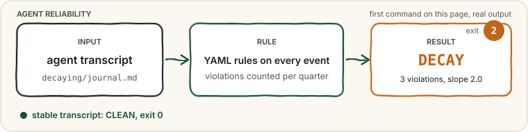

# constraint-auditor

**Your agent stopped following its own rules and nobody noticed.**


Agent reliability: audit agent transcripts against declared rules and fail CI when a rule breaks (exit 0, 2 or 1).

constraint-auditor is a command-line check that tests every event in an AI agent's transcript against rules that a person has declared in YAML. We built it because an agent can keep passing its tests while it stops following its rules, such as advancing after a failed lint check, and only the transcript records that change. Given rules that are regular expressions, each forbidden or required in every event, it counts the violations in each quarter of the transcript and returns exit 0 (CLEAN), 2 (DECAY) or 1 (ERROR) with an optional Markdown report, so that a CI job or an agent loop can stop when a rule breaks.

```bash
git clone https://github.com/homayoun-safarpour/agent-constraint-auditor
cd agent-constraint-auditor && pip install -e .
constraint-auditor audit --constraints examples/decaying/constraints.yaml --transcript examples/decaying/journal.md
```

```text
verdict=DECAY exit=2 violations=3 first_index=2 slope=2.000
```

That command exits 2. The same audit on `examples/stable/` exits 0.



[How it works](#how-it-works) · [Results](#what-each-result-means) · [Limits](#limits) · [Interview pack](docs/INTERVIEW.md) · [Cite](#citation) · Part of [a small open stack for checking AI agents and their judges](https://homayoun-safarpour.github.io)

## What each result means

| Verdict | Exit | Meaning |
| --- | --- | --- |
| `CLEAN` | 0 | No event matched a forbidden pattern, and every event matched every required pattern. |
| `DECAY` | 2 | At least one event matched a forbidden pattern or had a missing required pattern. |
| `ERROR` | 1 | The input could not be audited: bad arguments, a missing file, an invalid spec or invalid regex, an empty transcript or headerless transcript, a dated journal heading with no body, invalid or empty JSONL, a JSONL object missing timestamp, a JSONL timestamp not `YYYY-MM-DD HH:MM`, or a JSONL object missing text and fields. |

A `CLEAN` shows that the transcript kept every rule written in the spec. It does not show that the agent behaved well in ways the spec does not name. The exit of each of the nine example fixtures is in [examples/MATRIX.md](examples/MATRIX.md), and the limits of the claim are in [docs/RELIABILITY_CARD.md](docs/RELIABILITY_CARD.md).

## Use this when

| Situation | Use constraint-auditor? |
| --- | --- |
| Your agent writes an [agent-loop-engine](https://github.com/homayoun-safarpour/agent-loop-engine) journal or JSONL events, and its rules can be written as patterns | Yes |
| You need exit `0` or `2` so that GitHub Actions or agent-loop-engine can stop on a broken rule | Yes |
| You want a language-model judge to grade the agent's work | No. This tool only matches the patterns in your spec |
| You want to score tool calls against an approved run | No. Use [trace-gate](https://github.com/homayoun-safarpour/trace-gate) |
| Your transcript uses ISO timestamps such as `2026-08-11T09:00` | Not directly. Convert them to `YYYY-MM-DD HH:MM` first |

The package is not on PyPI yet. `pip install git+https://github.com/homayoun-safarpour/agent-constraint-auditor` is the other way to install it.

## The problem

Rules given to an agent, such as "do not advance when lint fails" or "never force-push", can hold early in a run and break later. A test suite checks the code of the agent and a final check sees only the last step, so neither shows when the rules began to break. The audit reads every event in order, reports the first event that broke a rule, and compares the violation rate at the end of the transcript with the rate at the start. An empty or unreadable transcript returns ERROR, because a log with no events would otherwise pass as CLEAN.

## How it works

Each rule in the YAML spec has an `id`, a `description` and a `pattern`, a regular expression matched against the text of each event without regard to case. With `forbid: true` (the default) a match is a violation. With `forbid: false` the pattern is required, so a missing required pattern in any event is a violation. A spec with an invalid regex, a duplicate `id` or no rules is ERROR (exit `1`). One rule from `examples/decaying/constraints.yaml`:

```yaml
  - id: never_skip_lint
    description: Do not advance when lint gate is FAIL
    pattern: "lint\\s*=\\s*FAIL"
    forbid: true
```

The audit splits the events into four quarters by position, divides the violations in each quarter by its number of events, and takes the Q4 rate minus the Q1 rate as the slope. `--report decay.md` on the first-screen command writes that result as Markdown (first lines shown; the file goes on to list each violation):

```text
# Constraint decay report: decaying-agent

Verdict: DECAY
The transcript records 3 constraint violations, first at event 2.

Events: 4 · Violations: 3
First violation index: 2
Decay slope (Q4-Q1 rate): 2.000
```

A clean run writes `Verdict: CLEAN` instead. `--json` prints the full result as JSON, and `constraint-auditor --version` prints `constraint-auditor 0.1.0`.

### Transcript formats

A journal is Markdown in which each event starts with a dated journal heading (`## YYYY-MM-DD HH:MM`), the shape that agent-loop-engine writes. With `--format jsonl`, or when the file has no dated heading and its first non-empty line starts with `{`, the tool reads one JSON object per line. Each object needs a non-empty string `timestamp` of shape `YYYY-MM-DD HH:MM` plus `text` and/or `fields`. `audit` and `parse-transcript` both accept `--format jsonl|journal|auto`.

A line missing `timestamp`, a timestamp that is not `YYYY-MM-DD HH:MM`, a line that is valid JSON but not an object, a `fields` value that is not a mapping, and a dated journal heading with no body text or fields all exit 1. A timestamp-only line is ERROR for the same reason. `parse-transcript PATH [--format jsonl|journal|auto]` runs the parser alone, and empty or headerless input exits 1 instead of printing `OK: 0 events`. Every parser case is listed in [docs/ADAPTER.md](docs/ADAPTER.md).

### The other fixtures

These commands exit 0, 2, 1, 1, 0, 2 and 1 in this order:

```bash
constraint-auditor audit --constraints examples/required_present/constraints.yaml --transcript examples/required_present/journal.md --report required-clean.md
constraint-auditor audit --constraints examples/required_missing/constraints.yaml --transcript examples/required_missing/journal.md --report required-decay.md
constraint-auditor audit --constraints examples/empty/constraints.yaml --transcript examples/empty/journal.md
constraint-auditor audit --constraints examples/headerless/constraints.yaml --transcript examples/headerless/journal.md
constraint-auditor audit --constraints examples/jsonl_stable/constraints.yaml --transcript examples/jsonl_stable/events.jsonl --format jsonl --report jsonl-clean.md
constraint-auditor audit --constraints examples/jsonl_decaying/constraints.yaml --transcript examples/jsonl_decaying/events.jsonl --format jsonl --report jsonl-decay.md
constraint-auditor audit --constraints examples/jsonl_bad_timestamp/constraints.yaml --transcript examples/jsonl_bad_timestamp/events.jsonl --format jsonl
```

| Module | What it does |
| --- | --- |
| `constraintauditor.spec` | Loads the YAML spec and rejects a bad one |
| `constraintauditor.journal` | Parses Markdown journals and JSONL transcripts into dated events |
| `constraintauditor.checkers` | Checks each event against each rule, with no model calls |
| `constraintauditor.decay` | Computes the quarter rates and the slope, and writes the report |
| `constraintauditor.cli` | The `audit`, `check-constraints` and `parse-transcript` commands |

Interview pack: [docs/INTERVIEW.md](docs/INTERVIEW.md), three questions and a two-minute demo.

## Limits

- It is not a language-model judge. It matches the patterns in your spec and does not judge the meaning of what the agent did.
- It checks only the rules you declare and does not infer rules from free-form chat.
- Every rule applies to every event, so a required pattern that should hold for only some events reports a violation on all the others.
- A rate counts violations per event, so it can exceed 1 when one event breaks two rules. A rule broken in every event gives a slope of 0.000 and is still DECAY (`examples/required_missing`), so the exit code is the gate and the slope is context.
- JSONL timestamps with `T`, seconds or a timezone are ERROR, so other trace formats need a converter first.
- It needs Python 3.10 or later and PyYAML. Every central claim has a named test under `tests/`.

## Use it as a gate in a loop

[agent-loop-engine](https://github.com/homayoun-safarpour/agent-loop-engine) can run the audit before it lets an agent continue. A failed gate makes the loop repair before it adds new work.

```bash
loop-engine tick --state LOOP_STATE.md \
  --gate "constraints=constraint-auditor audit --constraints constraints/agent.yaml --transcript journal/JOURNAL.md"
```

## Related tools

- [agent-loop-engine](https://github.com/homayoun-safarpour/agent-loop-engine): state, gates, the next-step decision and a journal for agent loops.
- [judge-drift-sentinel](https://github.com/homayoun-safarpour/judge-drift-sentinel): tells a change in the system from a change in the judge.
- [trace-gate](https://github.com/homayoun-safarpour/trace-gate): fails CI when the scores of agent runs fall below a frozen baseline.

## Contributing

The local loop is in [CONTRIBUTING.md](CONTRIBUTING.md), and [SECURITY.md](SECURITY.md) says how to report a vulnerability. Questions go to [Discussions](https://github.com/homayoun-safarpour/agent-constraint-auditor/discussions).

## Citation

Use the "Cite this repository" button on GitHub. The metadata is in [`CITATION.cff`](CITATION.cff).

## Author

Homayoun Safarpour - [LinkedIn](https://www.linkedin.com/in/homayoun-safarpour/)

## License

MIT. See [`LICENSE`](LICENSE).
